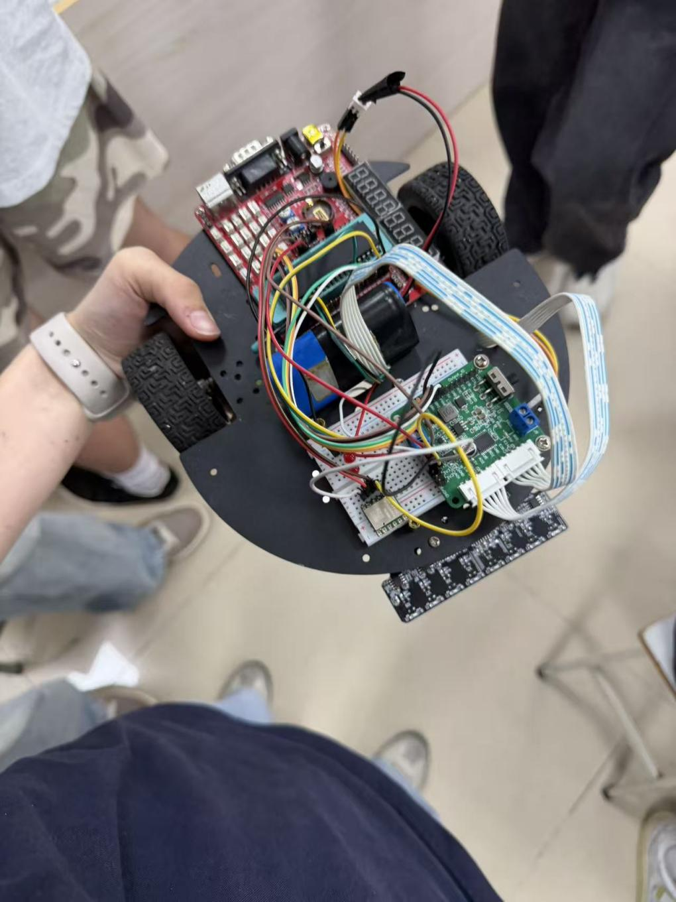
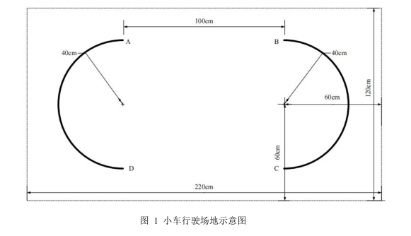
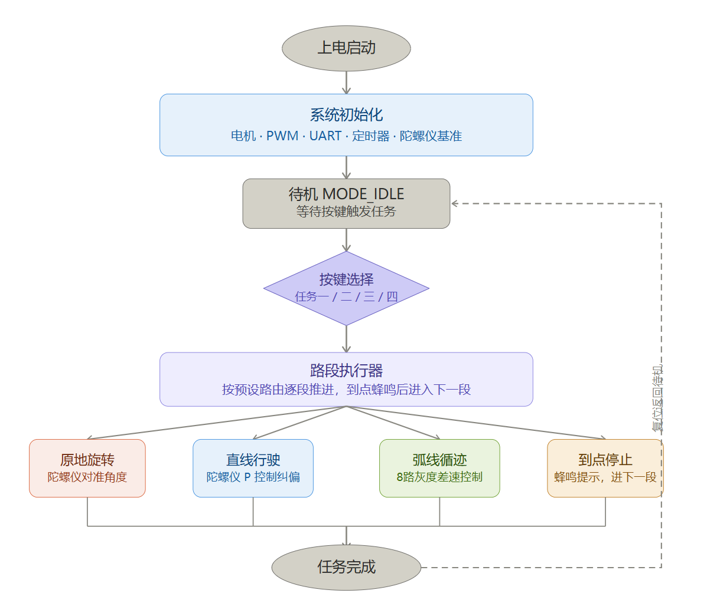
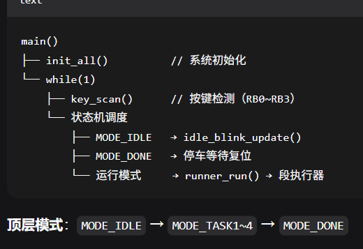

# PIC16F877A 自动行驶小车

> 《微机原理与接口技术》课程设计 · 4 人小组 · 题目取自 2024 年 TI 杯大学生电子设计竞赛 H 题
> 我负责整体架构、状态机设计与联调。



## 任务与难点

场地 220 × 120 cm，**只有两段 40 cm 半圆弧上有黑线**，直线段与斜线段没有任何视觉引导（见下图的 A→B、B→C 段）。



因此单一传感器路线走不通，必须双传感器分工、按点位切换控制源：

| 路段 | 传感器 | 控制方式 |
|---|---|---|
| A→B 直线、B→C 斜线 | JY62 陀螺仪 | 航向 Yaw 闭环，P 控制 |
| C→D、D→A 圆弧 | 8 路灰度 | 差速循迹 |
| 换向前后 | 陀螺仪 | 原地旋转到目标角 |

四档任务（基准 / 绕行 / 变速 / 四圈）的差异**只体现为一份路线表**，控制代码完全复用。

## 硬件

| 部件 | 型号 | 说明 |
|---|---|---|
| 主控 | PIC16F877A @ 4 MHz | 裸机，直接操作寄存器 |
| 姿态 | JY62 | UART 9600 bps，中断拼帧 |
| 循迹 | 8 路灰度 | **3 根地址线选通读 8 路**，省 4 个 IO |
| 驱动 | L298N | 硬件 PWM（CCP1/CCP2） |
| 电赛板 | 开拓者 1 号 | 电路图见 [`docs/开拓者1号-开发板电路图.pdf`](docs/开拓者1号-开发板电路图.pdf) |

## 软件架构

七层结构，上层不碰寄存器：

```
交互层    key_scan()               按键短按/长按 → 启动任务
调度层    runner_run()             按段推进，到点提示后进下一段
段执行层  run_spin / run_straight / run_arc / run_stop
控制层    straight_control_base()  直线 P 控制；弧线五档差速
传感器层  gray_read()  g_yaw       灰度 + 陀螺仪
硬件抽象  pwm_set()  motor_*()
中断层    isr()                    USART 拼帧 + TMR1 1 ms 时基
配置层    宏参数 / 引脚 / Segment / route 表
```





## 三个关键设计

**1. 路线表驱动，而不是四份 if-else**

`CarMode` / `SegType` / `Segment` 三个结构体把「走哪条路」从代码里抽出来变成数据。任务一~四分别是 `route1[]` / `route2[]` / `route3[]` / `route4[]`，调度器 `runner_run()` 只负责读表推进。加一条新赛道不用改控制逻辑。

**2. 直线段的 P 控制带三层约束**

单纯 `err × KP` 会蛇形摆动，因此叠了三层限制：

- **死区** 80（约 0.4°）—— 小偏差不修正，避免在目标航向上来回抖
- **误差缩放** `/64` —— 抑制小偏差被过度放大
- **输出限幅** ±180 —— 单侧最大 PWM 修正量，防止一侧轮子被压到停转

**3. 角度差必须归一化**

多字节 Yaw 原始值直接相减会在 ±32767 处跳变（359° → 1° 会算成 -358° 而不是 +2°）。`yaw_diff()` 系列把差值折回 ±180° 对应量程，这是全文件最容易踩坑的地方。

另外弧线段做了**三重出弯保护**：最少转过 145° 才允许判出弯（防止刚入弯就被灰度误判）、全白连续确认 8 次、出弯后进入直线时先忽略黑线 700 ms（防止重复判点）。

## 实测结果

| 任务 | 时限 | 实测 | 余量 |
|---|---|---|---|
| 任务一（基准行驶） | 15 s | **3 s** | 80% |
| 任务二（绕行） | 30 s | **12 s** | 60% |
| 任务三（变速） | 40 s | **13 s** | 68% |
| 任务四（四圈） | 100 s | **56 s** | 44% |

## 我的分工

- 整体软件架构与控制流程设计
- 状态机（`CarMode` / `SegType` / 路线表）与段调度器
- 直线段陀螺仪 P 控制、弧线差速控制
- 全组联调与参数整定

## 目录

```
src/       task1.c（1152 行）+ MPLAB X 工程与启动文件
firmware/  task1.hex（可直接烧录）
docs/      课程报告 PDF、任务书、评分表、开发板电路图、代码逐行精读页
docs/images/  报告内嵌图片（42 张）
```

## 文档

- [课程设计报告（PDF，3.9 MB）](docs/report.pdf)
- [task1.c 逐行精读（HTML）](docs/code-walkthrough.html)
- [课程设计任务书](docs/课程设计任务书-自动行驶系统-通信24.pdf)
- [评分标准](docs/24级微机课程设计--小车行驶系统评分.pdf)
