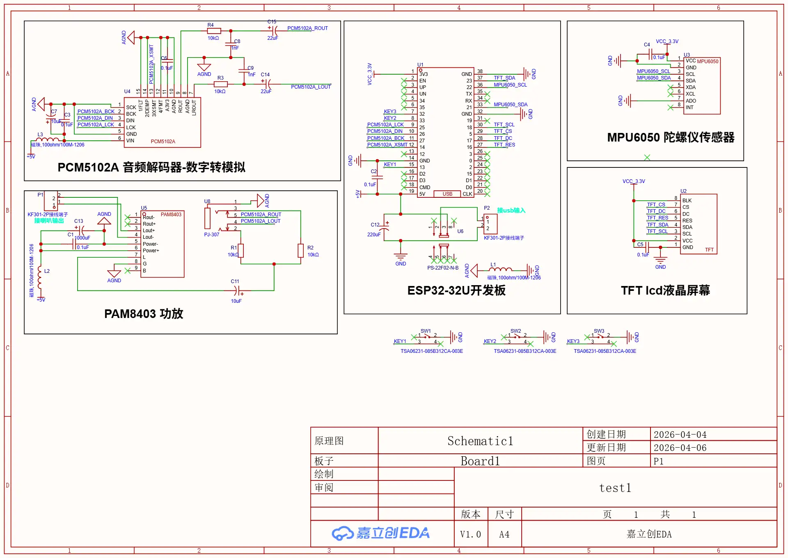
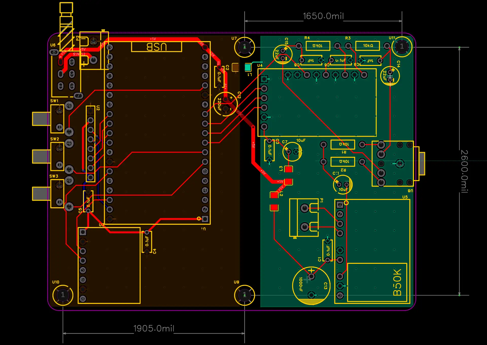

# ESP32 磁流体视觉蓝牙音响

> 个人项目 · 从原理图、双层 PCB、打样焊接到固件全部独立完成 · 整机已焊通可正常播放

<!-- TODO: 补实物照片。建议拍三张：整机正面（屏幕亮着）、PCB 焊接面特写、桌面使用场景 -->

## 它是什么

一块 240×240 圆屏 + 一个蓝牙音箱。播放音乐时，屏幕上的磁流体形态随音频频段能量实时变化：低频让触角外扩，中频让核心脉动，高频驱动环上的粒子。





## 硬件

| 项目 | 内容 |
|---|---|
| 主控 | ESP32-32U 开发板（双核 240 MHz） |
| 音频解码 | PCM5102A（I2S → 模拟，带 XSMT 静音控制） |
| 功放 | PAM8403（3 W 双声道，BTL 输出） |
| 显示 | TFT LCD 240×240（SPI） |
| 姿态 | MPU6050 六轴（I2C，用于屏幕方向自适应） |
| 交互 | 3 × TSAG6231 轻触按键（KEY1~KEY3） |
| PCB | 双层，1905 × 2600 mil（约 48 × 66 mm），嘉立创打样 |

原理图与 PCB 工程：[`hardware/esp32-speaker.epro2`](hardware/)（嘉立创 EDA 专业版，导入后可直接打开）

<!-- TODO: 补 Gerber 导出、BOM、以及 PCB 正反面渲染图 -->

## 双核架构

按「谁必须准时」分工，不按「谁代码多」分：

```
Core 0 ── A2DP 回调 audioDataCallback() ──> sampleBuf[256] + newSamples 标志
                                              │
Core 1 ── loop() ── analyzeAudio()  ─────────┘   → bass / mid / high
                ├─ updatePhysics()      触角 / 核心 / 环参数
                ├─ updateDroplets()     粒子物理
                ├─ renderRing / renderFluid / renderStandby / renderDroplets
                └─ spr.pushSprite()     全屏一次性刷
```

Core 0 只做一件事：把蓝牙协议栈收到的 PCM 样本搬进缓冲区，不做任何计算。Core 1 负责分析与渲染。**音频流不会因为渲染慢而断**。

## 两个关键取舍

**1. 8 bit 色深，把全屏缓冲从 115 KB 压到 58 KB**

240×240 全屏 Sprite 双缓冲在 16 bit 色深下要 115 KB，ESP32 里蓝牙协议栈本身就吃掉大量堆内存，再要 115 KB 会直接分配失败。改成 8 bit 色深（`COLOR_DEPTH_8`）后压到 58 KB，实测约 **20 FPS**，肉眼看不出明显色带。

**2. 不做 FFT**

音频分析从 PCM 流取 256 点，按时域直接切成三段求能量，再经一阶平滑——算力预算不允许 FFT，而这个场景只需要「低/中/高三档强度」，时域能量完全够用。

## 踩过的两个坑

**初始化顺序**：必须先创建 Sprite 再初始化 A2DP。反过来会因为在蓝牙协议栈占完堆之后再申请 58 KB 而失败，表现为开机进不去。

**功放爆音**：蓝牙空闲（无连接/无播放）时功放会持续输出底噪。解法是 XSMT 静音脚 + 2 秒无数据超时自动静音。

## 当前状态

验证版。功能完整（蓝牙播放 + 实时可视化 + 20 FPS），受功放底噪限制未做成品外壳。

## 目录

```
firmware/Sandspeaker/   Sandspeaker.ino（487 行，Arduino IDE 直接打开）
hardware/               嘉立创 EDA 专业版工程（.epro2）
```

## 待补充

- [ ] 实物照片（整机 / PCB 焊接面）
- [ ] Gerber 文件与 BOM
- [ ] 演示视频
